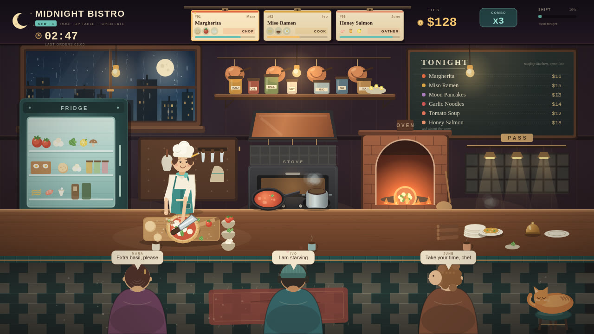
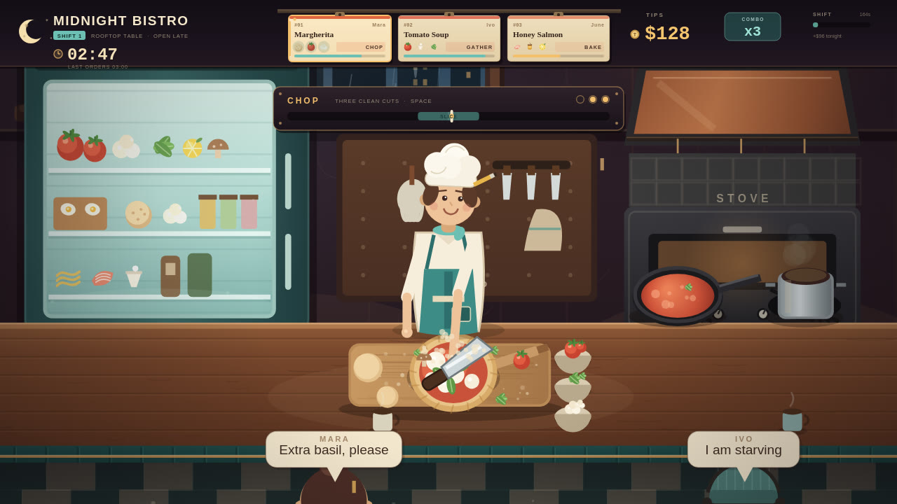
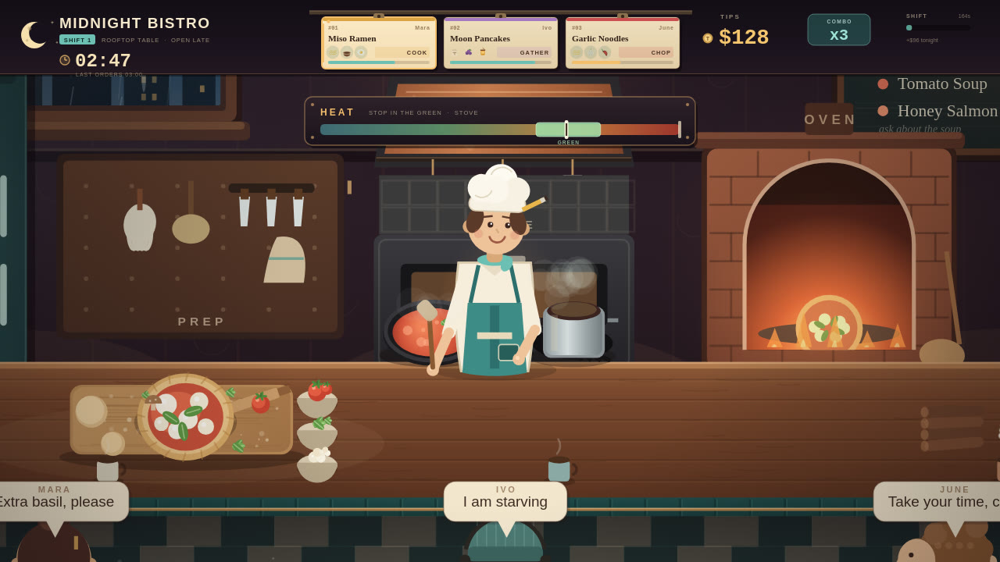
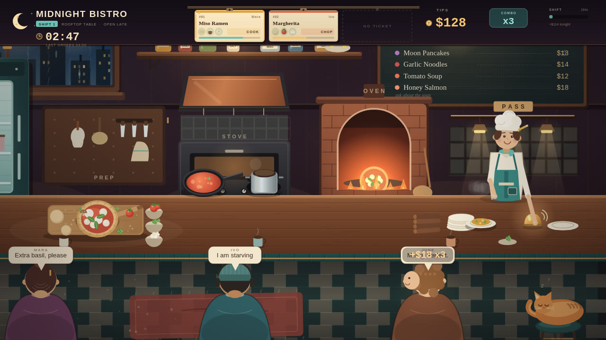

# Midnight Bistro

[](https://make.fun/c/best-cooking-game-20261125-0137)
[](https://make.fun/c/best-cooking-game-20261125-0137)
[](https://make.fun/c/best-cooking-game-20261125-0137)

Midnight Bistro is a small, hand-painted cooking game set in a rooftop kitchen that stays open late. Three regulars take seats under the rain and order from a six-dish menu. Walk the counter, gather ingredients, chop, cook and plate each ticket before patience runs out. Quick, clean work builds a combo and bigger tips. Keep the pass moving until last orders at 03:00.

Everything is drawn with Canvas 2D at a fixed 1280x720 logical size, letterboxed to the window. There are no images, libraries, web fonts or network requests. The game runs from static files with no build step.

## Run it

Open `game/index.html` directly in a desktop browser. It works offline from the file system.

Or serve the folder locally:

```sh
node serve.ts
```

Then open http://localhost:8080.

## Controls

| Input | Action |
| --- | --- |
| `A` / `D` or arrow keys | Walk left and right along the counter |
| `E` | Work the station nearest the chef |
| `Space` | Chop when the knife is over the board, or stop the heat in the green band |
| `1` to `8` | Pick an ingredient from the tray |
| `1` to `3` | Serve the matching customer |
| `Tab` | Open or close the recipe book |
| `P` | Pause |
| `M` | Mute |
| `Esc` | Close the book or the tray |
| Mouse | Click stations, tray chips and customers |

Walk to a station and press `E` to start its step. Gather every ingredient, chop three clean cuts, cook inside the green band, then plate and ring the bell at the pass. The highlighted ticket is the active order, and the ticket rail always shows each order's next step.

## Screenshots









The four screenshots are real 1280x720 game renders. They are produced deterministically by the official capture script from the `?shot=cover|chop|stove|serve&seed=7` states.

## Layout

```
game/index.html       page shell, canvas and styles
game/src/             game modules: config, kitchen, recipes, orders, cooking, player, render, hud, particles, audio, input, shots
shots.json            screenshot names and query strings
screenshots/          four hand-in JPEGs
main.ts               copies game/ and screenshots/ to the output directory and writes dossier.json
serve.ts              tiny local static server
vendor/               make.fun dossier builder
```
